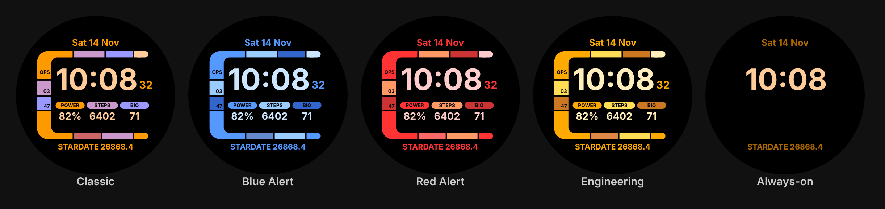

# Stardate Ops — LCARS-inspired watch face for Galaxy Watch 7



A starship-console style digital watch face built with **Watch Face Format (WFF)**,
the declarative format Samsung and Google require for Wear OS 5 (Galaxy Watch 7).
No app code, so there's no battery drain from background services.

## Features

| Element | Details |
|---|---|
| Time | Big digital time, follows your phone's 12/24h setting |
| Seconds | Can be switched off in the watch face editor |
| Date | Day, date, month along the top |
| Readouts | **POWER** (battery %), **STEPS**, **BIO** (heart rate) |
| Stardate | A fan-style stardate: `(year − 2000) × 1000 + fraction of year`, plus a tenths digit that ticks through the day |
| Themes | Classic, Blue Alert, Red Alert, Engineering |
| Always-on | Frame and readouts switch off; only time, date and stardate stay lit (saves battery, avoids burn-in) |

Customise it: long-press the watch face → **Customise** → pick a theme / toggle seconds.

## Get the APK

**Option A, GitHub Actions (no tools needed):** every push that touches this folder runs
`.github/workflows/stardate-watchface.yml`. Open the run under the repo's **Actions** tab and
download the `stardate-ops-watchface-apk` artifact (zip containing `app-release.apk`).

**Option B, Android Studio:** open this folder (`projects/watchfaces/stardate-ops`) and
choose **Build → Build APK(s)**, or from a terminal with the Android SDK installed:

```bash
cd projects/watchfaces/stardate-ops
./gradlew assembleRelease
# -> app/build/outputs/apk/release/app-release.apk
```

## Install on the Galaxy Watch 7

1. On the watch: **Settings → About watch → Software → tap "Software version" 5×**
   to unlock Developer options.
2. **Settings → Developer options →** turn on **ADB debugging** and **Wireless debugging**.
   Tap *Wireless debugging → Pair new device* to get a pairing code and IP:port.
3. On a PC with [platform-tools](https://developer.android.com/tools/releases/platform-tools):
   ```bash
   adb pair <ip>:<pairing-port>      # enter the code shown on the watch
   adb connect <ip>:<port>           # the port on the main Wireless debugging screen
   adb install app-release.apk
   ```
4. Long-press the current watch face, swipe to the end, tap **+ Add watch face**
   and choose **Stardate Ops**.

No PC handy? Phone apps like *Bugjaeger* or *Wear Installer 2* can sideload an APK
over Wi-Fi using the same wireless debugging pairing.

## Make it look even more authentic (optional)

Proper LCARS screens use a tall condensed typeface. The face currently uses the watch's
system font. To swap in the free **Antonio** font (SIL Open Font License, from Google Fonts):

1. Download `Antonio-Bold.ttf` and save it as `app/src/main/res/font/antonio_bold.ttf`
   (lowercase letters, digits and underscores only).
2. In `app/src/main/res/raw/watchface.xml`, add `family="antonio_bold"` to each `<Font …>` tag.
3. Since Antonio is narrower, you can raise the time `size` from `84` to about `110`.

## Editing the design

* Layout lives entirely in `app/src/main/res/raw/watchface.xml` (450×450 canvas).
* Themes are the `ColorOption` rows near the top; colours are `#AARRGGBB`.
* Re-render previews after editing:
  ```bash
  python3 tools/render_preview.py app/src/main/res/raw/watchface.xml /tmp/face.svg 0
  python3 tools/render_preview.py app/src/main/res/raw/watchface.xml /tmp/aod.svg 0 --ambient
  ```
  (An approximate renderer for layout checks only. The watch itself is the source of truth.)

## Notes

* Heart rate shows the watch's last reading. If it shows `0`, open Samsung Health once
  so a measurement exists.
* The release build is signed with the debug key so it can be sideloaded immediately.
  Add your own signing config before publishing to Google Play.
* This is an unofficial, fan-made design inspired by sci-fi console UIs. It uses no
  studio logos, artwork or trademarks.
