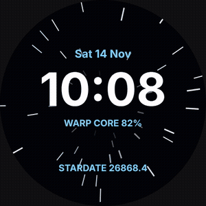
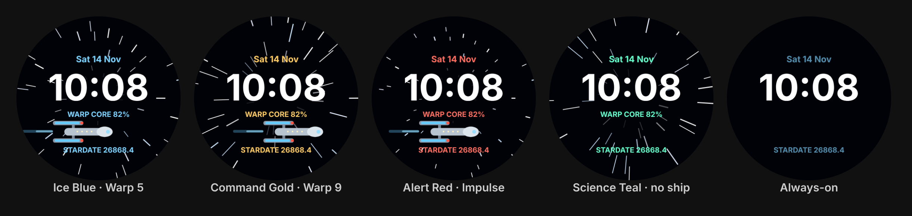

# Warp Drive: animated starfield watch face for Galaxy Watch 7





Star streaks rush outward from the centre of the screen as if you're at warp, and once a
minute (at about :20 seconds) a starship flies across with its nacelles glowing. Built with
**Watch Face Format (WFF)**, so there's no app code and no background service.

## Customise

Long-press the face → **Customise**:

| Setting | Options |
|---|---|
| Accent colour | Ice Blue, Command Gold, Alert Red, Science Teal |
| Warp speed | Impulse (slow drift), Warp 5, Warp 9 (long streaks) |
| Starship flyby | On / Off |

Always-on mode turns off the stars and the ship, leaving the time, date and stardate dimmed, to save battery.

## Get it on the watch

Same as Stardate Ops (see `../stardate-ops/README.md` for the full steps):

1. Download the `warp-drive-watchface-apk` artifact from the GitHub Actions run,
   or build it with `./gradlew assembleRelease`.
2. Turn on ADB and Wireless debugging on the watch, then `adb install app-release.apk`.
3. Long-press the watch face → **+ Add watch face** → **Warp Drive**.

## Editing

`app/src/main/res/raw/watchface.xml` is **generated**. Don't edit it by hand.
Change `tools/generate.py` (star count, speeds, ship shape, colours), then:

```bash
python3 tools/generate.py                           # rewrite watchface.xml
python3 tools/generate.py --frame 24.5 /tmp/f.svg   # preview one moment (seconds)
#   options: --speed 0|1|2  --accent 0..3  --ambient  --no-ship
```

CI fails if the XML is out of date with the generator.

## How the animation works

Each star is a thin rectangle in a rotated layer. Its distance from the centre is
`(seconds × speed + phase) mod 250`, so it slides outward, stretches and fades in.
Each loop length divides evenly into 60 seconds, so there's no jump when the minute ticks over.
The ship's x-position is just `(seconds − 20) × 60`, which keeps it off-screen
except for about ten seconds each minute.

## Notes

* The animation runs while the screen is awake. Animated faces use somewhat more battery than
  static ones. Choose **Impulse** or turn off the flyby to lower the load.
* The starship is an original design (needle hull, twin nacelles), not any studio's ship.
  This is an unofficial fan-made face with no studio logos or artwork.
